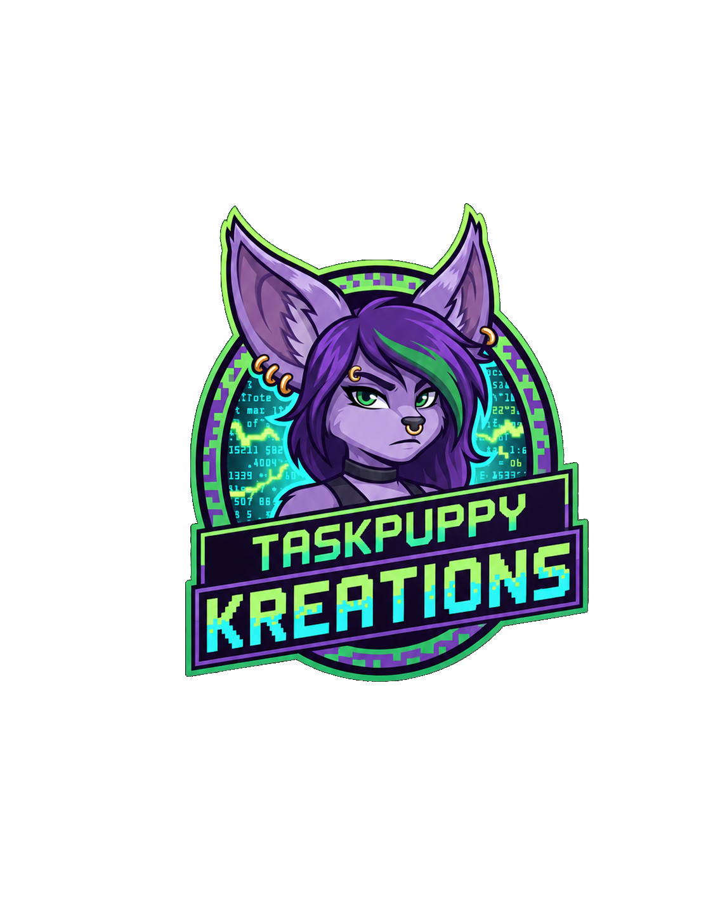
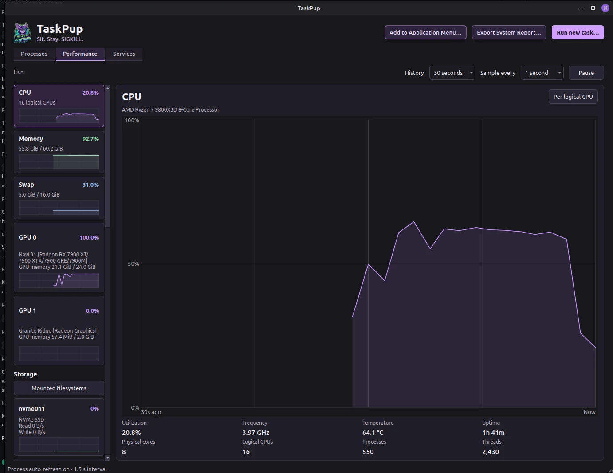

<p align="center">
  
</p>

<h1 align="center">TaskPup</h1>

<p align="center"><strong>A clear view of your Linux system, with the tools to act.</strong></p>

<p align="center">
  
  
  
  
</p>

TaskPup is a native desktop task manager for Linux. Inspect and control processes, watch system performance, manage systemd services, and export system diagnostics from one Qt application.

<p align="center">
  
</p>

<p align="center"><em>TaskPup's Performance dashboard on LMDE 7 Cinnamon/X11. CPU, memory, and GPU readings shown are host-system measurements, not TaskPup's own resource use.</em></p>

## What you can do

- **Find and manage processes.** Search, sort, inspect process details, view parent and child relationships, and send signals with identity-safety checks.
- **Monitor system performance.** Follow CPU, memory, swap, storage, and network activity over time.
- **Inspect GPUs.** View available AMD GPU telemetry through Linux DRM, `amdgpu` sysfs, and hwmon. Readings vary by device and driver.
- **Manage systemd services.** Inspect system and user units; service actions follow the desktop user's authorization and system Polkit rules.
- **Export diagnostics.** Save HTML, Markdown, JSON, JSONL, or ZIP reports. Privacy-Protected Diagnostics is the default; Full Diagnostics asks for confirmation.

See the [user guide](docs/USER_GUIDE.md) for controls, metric definitions, hardware caveats, and report details.

## Install

### From source

Requires Python 3.11 or newer. Run as your regular desktop user:

```bash
python3 -m venv .venv
.venv/bin/python -m pip install -e .
.venv/bin/taskpup
```

On LMDE, install the distribution's `python3-venv` package if virtual-environment creation is unavailable. Qt's X11 backend also requires XCB libraries, including `libxcb-cursor0`.

### AppImage

AppImage packaging is available for evaluation, but **no official AppImage release has been published yet**. Do not download AppImages from unofficial locations. Build and provenance details are in the [AppImage packaging guide](packaging/appimage/README.md).

## Tested environments

TaskPup has been tested on **LMDE 7 with Cinnamon/X11** and **Linux Mint 22.3 with XFCE/X11**. AppImage menu integration, icon display, and launching were user-validated on those desktop setups. These results do not establish compatibility with every Linux distribution, driver, or desktop environment. Wayland has not been verified.

Detailed hardware and platform notes are in the [user guide](docs/USER_GUIDE.md).

## Safety and limitations

TaskPup refuses to run as root and uses the desktop user's permissions. Process priority and CPU-affinity changes are disabled for process-identity safety. Process signaling uses Linux pidfds where available; TaskPup protects PID 1, kernel threads, and itself. See [process safety and metric caveats](docs/USER_GUIDE.md#process-safety-and-limitations).

## Contributing and technical documentation

- [Development setup and checks](CONTRIBUTING.md)
- [User guide and technical notes](docs/USER_GUIDE.md)
- [AppImage build and provenance](packaging/appimage/README.md)
- [Project metadata and dependencies](pyproject.toml)

## Branding

The logo above is the official [TaskPuppy Kreations artwork](assets/TaskPuppyLogo.png). AppImage and launcher packaging use a separate [launcher icon](assets/branding/appimage-icon.png); the original in-app logo remains unchanged.
